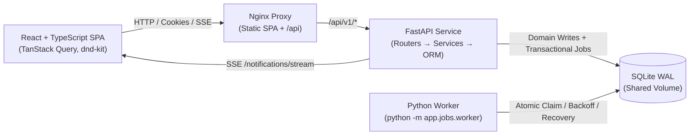
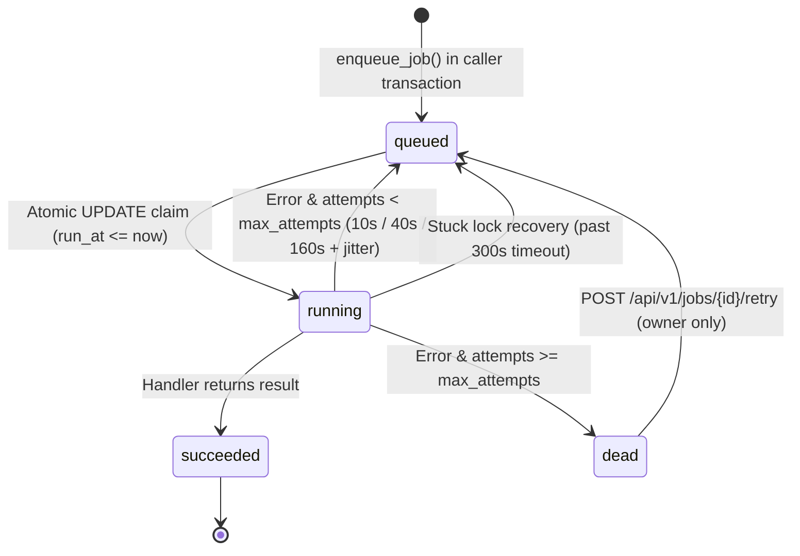

# Agile Project Management Tool

A full-stack Agile project management web application built for small teams (3–10 users) around a structured **Project → User Story → Task** hierarchy. Powered by **FastAPI**, **SQLAlchemy 2**, **Alembic**, and **SQLite (WAL)** with a **React + TypeScript + Tailwind + TanStack Query + dnd-kit** frontend and a standalone durable background worker.

## Features

- **Project → Story → Task Hierarchy**: Per-project atomic story numbering (`APM-1`, `APM-2`), fractional drag-and-drop ranking with automatic rebalancing, soft delete with cascade, and optimistic concurrency via `version` (`409 Conflict` with one-click UI reload).
- **Dual Workspace Views**: URL-synced **Outline** (expandable tree, inline editing, quick-add parser `title @assignee !priority due:date`, status/assignee/search filters) and **Board** (4-column Kanban with `dnd-kit` optimistic drag-and-drop) plus a right-side **Focus Panel** drawer.
- **Pure Rollups & Health**: Weighted/unweighted story progress rails, blocked indicators, automatic status suggestions (`In Progress`, `In Review`), and project health (`On track`, `At risk`, `Off track`) computed in constant queries without N+1.
- **Role-Based Access Control**: `owner`, `member`, and `viewer` roles enforced centrally via `require_project_role`. Non-members receive `404` (no resource enumeration), viewers see read-only views with mutation controls hidden, and the last project owner cannot be removed or demoted.
- **Durable Async Job Queue (No Redis)**: Transactional SQLite `jobs` table with `idempotency_key` deduplication, atomic multi-worker claiming, exponential backoff with jitter (`10s / 40s / 160s`), dead-lettering + owner retry, and stuck-job lock recovery.
- **Collaboration & Reporting**: Transactional notifications on assignment and status changes, live **SSE** top-bar notification bell with `Last-Event-ID` reconnect, hourly `due_soon_reminder` scheduler, paginated project activity feed, and asynchronous Markdown status reports (`202 Accepted` + `.md` download).

## Architecture



See [docs/architecture.md](docs/architecture.md) for layering details.

## Quick Start (Docker Compose)

Create a `.env` file with a strong `SECRET_KEY` (at least 32 characters; `APP_ENV=production` refuses to start with a default or short secret). For local HTTP demos, set `SESSION_COOKIE_SECURE=false` and `SEED_DEMO=true`:

```bash
git clone https://github.com/Katakam-Krupavathi/Agile-Project-Management-Tool.git
cd Agile-Project-Management-Tool
printf "SECRET_KEY=replace-with-at-least-32-random-bytes-secret-key\nSESSION_COOKIE_SECURE=false\nSEED_DEMO=true\n" > .env
docker compose up --build
```

- **Web App**: `http://localhost:5173`
- **API**: `http://localhost:8000` (Swagger `/docs` and `/openapi.json` are enabled in development or when `ENABLE_API_DOCS=true`, and disabled by default in production)

### Demo Accounts (Opt-In via `SEED_DEMO=true`)

`SEED_DEMO` defaults to `false` in `docker-compose.yml` for safe production deployments. When `SEED_DEMO=true` is set (or when running `python -m app.db.seed` locally), an idempotent demo workspace (3 users, 2 projects, 8 stories, 25 tasks, and 1 sample report) is seeded:

| Role | Email | Password |
| --- | --- | --- |
| **Owner** | `alex@agilepm.dev` | `DemoPass123!` |
| **Member** | `sam@agilepm.dev` | `DemoPass123!` |
| **Viewer** | `jordan@agilepm.dev` | `DemoPass123!` |

## Local Development

### 1. Backend & Worker

```bash
cd backend
python -m venv .venv
# Windows: .\.venv\Scripts\activate  |  macOS/Linux: source .venv/bin/activate
pip install -e ".[dev]"
alembic upgrade head
python -m app.db.seed
uvicorn app.main:app --reload
```

In a second terminal, start the standalone background worker:

```bash
cd backend
# activate .venv
python -m app.jobs.worker
```

### 2. Frontend

```bash
cd frontend
npm install
npm run dev
```

Open `http://localhost:5173` (Vite proxies `/api` to `http://localhost:8000`).

## Data Model & API Documentation

- **Schema & ER Diagram**: [docs/schema.md](docs/schema.md)
- **API Reference & `curl` Examples**: [docs/api.md](docs/api.md)
- **Exported OpenAPI Spec**: [docs/openapi.json](docs/openapi.json) (live UI at `/docs`)

Quick `curl` check:

```bash
curl -s http://localhost:8000/api/v1/health
```

## Async Workflow & Failure Recovery



- **Transactional outbox**: Jobs are inserted inside the caller's DB transaction so a rolled-back mutation never leaves orphaned background work.
- **Retry & Dead-lettering**: Transient failures are retried after `10s`, `40s`, and `160s` (+ 0–10% jitter). After `max_attempts`, jobs transition to `dead`, where project owners can inspect `last_error` and click **Retry**.
- **Crash recovery**: Jobs left in `running` beyond the lock timeout (300s) are reclaimed back to `queued` (or `dead` if attempts are exhausted).

Full details: [docs/async-workflow.md](docs/async-workflow.md).

## Design Decisions & Tradeoffs

| Area | Choice | Tradeoff |
| --- | --- | --- |
| **Database** | SQLite (WAL + `foreign_keys=ON`) | Zero-ops setup for 3–10 users; single-writer ceiling under heavy concurrency. |
| **Job Queue** | SQLite `jobs` table + polling worker | Transactional enqueue without Redis; ~1s poll latency and shared DB I/O. |
| **Auth** | `httpOnly` `SameSite=Lax` signed cookie + double-submit CSRF | Immune to XSS token theft; requires `X-CSRF-Token` header on mutations. |
| **Ordering** | Fractional float positions with gap rebalancing | O(1) drag-and-drop updates; occasional column rebalance when gap ≤ `1e-6`. |
| **Concurrency** | Explicit `version` field (`409` on stale write) | Prevents silent overwrites; clients must supply `version` on `PATCH`. |
| **Live Updates** | Server-Sent Events (SSE) with `Last-Event-ID` | Simple HTTP/1.1 streaming and reconnect; unidirectional server-to-client. |

Full table: [docs/decisions.md](docs/decisions.md).

## Security & Honest Limitations

Implemented: Argon2id password hashing with constant-time dummy verification for unknown users, `httpOnly` `SameSite=Lax` cookies (`Secure` by default in production) with `token_version` server-side session revocation on logout (and per-poll SSE session re-validation), constant-time double-submit CSRF, multi-layer rate limiting (per-(IP, email) login, per-IP login across emails, per-account progressive soft backoff, and per-IP registration rate limiting), `--proxy-headers` + `FORWARDED_ALLOW_IPS` behind Nginx, production `SECRET_KEY` (>= 32 chars) startup validation, gated `/docs` & `/openapi.json` in production, centralized RBAC with `404` anti-enumeration, Pydantic input length limits, 1 MB request body limit (`413`), API + Nginx HSTS/CSP security headers, explicit CORS allow-list, and CI `pip-audit` + `npm audit`.

**Honest limitations** (see [docs/security.md](docs/security.md)):
- SQLite allows only one writer at a time (`BEGIN IMMEDIATE` + `busy_timeout=5000` serializes concurrent writes).
- Rate limiting and per-user SSE stream caps are in-memory per process (resets on restart).
- No email verification or password reset flow (`ConsoleMailer` logs to stdout).
- No MFA or SSO/OAuth.
- Logout increments `users.token_version`, revoking all active sessions for that user rather than tracking individual device sessions separately.

## Testing & Linting

```bash
# Backend (ruff + 44 pytest tests)
cd backend
ruff check .
pytest -v

# Frontend (ESLint + 11 Vitest tests + TypeScript/Vite build)
cd frontend
npm run lint
npm test
npm run build
```

## AI Usage Note

- **What AI helped with**: Scaffolding FastAPI/SQLAlchemy boilerplate, React design-system primitives, Vitest/pytest test cases, and Markdown documentation structure across each phase.
- **What was reviewed and verified**: Every commit was verified locally with `ruff`, `pytest`, `eslint`, `vitest`, `tsc -b`, and `vite build`, and checked against GitHub Actions CI before pushing. All authorization boundaries, SQLite WAL pragmas, RFC 7807 error envelopes, and palette constraints were audited directly.
- **Concrete examples where AI was wrong and corrected**:
  1. The initial `.gitignore` included a bare `lib/` rule from a Python template, which silently ignored `frontend/src/lib/api.ts` and `frontend/src/lib/types.ts` until `git status` review caught it and narrowed `.gitignore`.
  2. In the Phase 4 Alembic migration, passing `"ck_jobs_status_valid"` to `batch_op.drop_constraint()` collided with SQLAlchemy's `NAMING_CONVENTION` (double-prefixing it to `ck_jobs_ck_jobs_status_valid`), which broke migration tests until replaced with `op.f("ck_jobs_status_valid")`.

## What I'd Improve Next

1. **PostgreSQL** for multi-writer concurrency, `SELECT ... FOR UPDATE SKIP LOCKED` job claims, and full-text search indexes.
2. **Redis + Celery / Dramatiq** plus Redis-backed rate limiting and session revocation for horizontal multi-replica scaling.
3. **WebSockets** for real-time collaborative board cursors and instant multi-user card movement sync.
4. **SSO / OAuth2 (OIDC)** and TOTP MFA for enterprise teams.
5. **Email Verification & Transactional SMTP/SES** replacing `ConsoleMailer` with real outbound email delivery and password reset tokens.
6. **File Attachments & Comments** on stories/tasks with virus scanning and object storage (S3/GCS).
7. **External Integrations** (GitHub PR linking, Slack webhooks) via the existing durable job queue.
8. **Observability**: OpenTelemetry tracing, Prometheus metrics (job latency, queue depth, dead-letter count), and centralized structured log aggregation.
