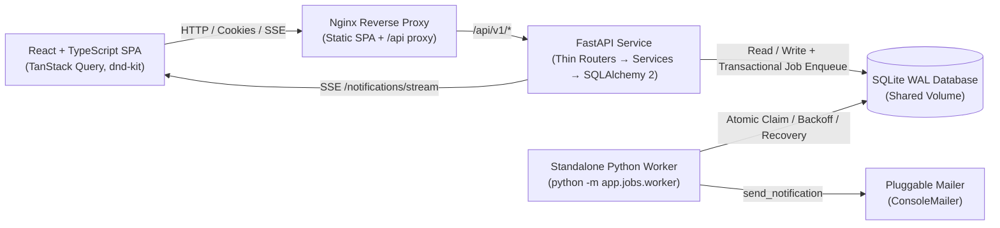

# System Architecture

The **Agile Project Management Tool** is a three-process web application designed for small engineering teams (3–10 users), sharing a single SQLite (WAL) database volume across the API and background worker.

## Component Overview

## Backend Layering

1. **Routers (`backend/app/api/v1/endpoints/`)**: Thin HTTP adapters responsible solely for request parsing, dependency injection (`get_current_user`, `require_csrf`, `require_project_role`), and delegating to services. Route handlers perform zero direct database queries.
2. **Central Authorization (`backend/app/services/permissions.py`)**: Every project-, story-, and task-scoped endpoint enforces `require_project_role` / `require_story_role` / `require_task_role`. Non-members receive `404 Not Found` to prevent resource enumeration; insufficient roles receive `403 Forbidden`.
3. **Domain Services (`backend/app/services/`)**: Business logic, optimistic concurrency checks (`version`), atomic per-project story numbering, fractional ranking (`ranking.py`), pure DB-free rollups (`rollup.py`), audit logging (`activity.py`), and transactional job enqueueing (`jobs/queue.py`).
4. **Data Layer (`backend/app/db/`, `backend/app/models/`)**: SQLAlchemy 2 typed ORM models with Alembic migrations (`render_as_batch=True`), FK/CHECK constraints, and SQLite pragmas (`journal_mode=WAL`, `foreign_keys=ON`, `busy_timeout=5000`).
5. **Async Worker (`backend/app/jobs/`)**: Separate process polling the `jobs` table via atomic conditional `UPDATE ... RETURNING id`, executing `@register("job_type")` handlers with exponential backoff + jitter and stale lock recovery.

## Frontend Architecture

- **Design System (`frontend/src/components/ui/`)**: Strictly constrained palette (Indigo `#1E2A5E`, Teal `#0F9D8A`, and five neutrals), `Inter` font, 8px radius, 4px spacing scale.
- **State & Caching**: TanStack Query manages server state, optimistic Kanban drag-and-drop updates with rollback on `409 Conflict`, and automatic `Reload` prompts.
- **Live Collaboration**: `NotificationsBell` maintains an authenticated `EventSource` SSE connection to `/api/v1/notifications/stream` with `last_event_id` reconnect resumption.
