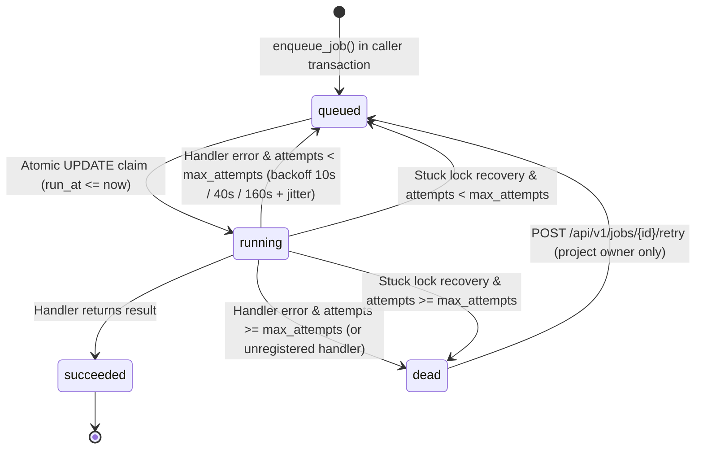

# Asynchronous Workflow & Durable Job Queue

The application runs asynchronous work using a **SQLite-backed durable job queue** (no Redis or external broker required). Jobs are stored in the same SQLite (WAL) database as domain data, which gives the system **transactional outbox** semantics: a job is committed atomically alongside the business mutation that triggered it, and rolled back if the mutation fails.

## Job Lifecycle State Diagram



## Core Mechanisms

### 1. Transactional Enqueue & Idempotency
- `app.jobs.queue.enqueue_job(db, job_type, payload, ...)` writes to `jobs` inside the caller's active SQLAlchemy session using a savepoint (`db.begin_nested()`) without committing prematurely.
- Callers may pass an `idempotency_key` (enforced by a `UNIQUE` constraint). Re-enqueueing with the same key returns the existing `Job` row rather than creating duplicate work.

### 2. Atomic Claiming (Multi-Worker Safe)
- Workers poll for due jobs (`status = 'queued'` and `run_at <= now`) ordered by `(run_at ASC, created_at ASC)` using a single conditional SQL `UPDATE ... RETURNING id`:
  - Sets `status = 'running'`, `locked_by = <worker_id>`, `locked_at = <now>`, and increments `attempts`.
  - The `WHERE` clause re-checks `status = 'queued' AND run_at <= now`. Under SQLite WAL's serialized writers, two concurrent workers cannot claim the same job.

### 3. Exponential Backoff with Jitter & Dead-Lettering
- Default `max_attempts` is `4` (1 initial execution + up to 3 retry backoffs).
- When a handler raises an exception:
  - Full error details (`<ExceptionType>: <message>`) are recorded in `jobs.last_error` (truncated to 2,000 characters), while API responses (`GET /api/v1/jobs/{id}`) return a sanitized summary (`<ExceptionType>: Job execution failed.`).
  - If `attempts < max_attempts` (`max_attempts = 4`), the job returns to `queued` with `run_at = now + delay`:
    - Attempt 1 fails (`attempts = 1 < 4`) → `10s` base (`10.0s – 11.0s` with 0–10% jitter)
    - Attempt 2 fails (`attempts = 2 < 4`) → `40s` base (`40.0s – 44.0s` with 0–10% jitter)
    - Attempt 3 fails (`attempts = 3 < 4`) → `160s` base (`160.0s – 176.0s` with 0–10% jitter)
  - When Attempt 4 fails (`attempts = 4 >= max_attempts`), or if no handler is registered for `job_type`, the job transitions to `dead`.

### 4. Stuck-Job Recovery, Lock Heartbeat & Timed Maintenance
- While a job handler is executing, the worker runs a background **lock heartbeat** thread (`refresh_job_lock`, default every `60s`) that refreshes `locked_at` so long-running handlers are never mistakenly reclaimed as stuck.
- On a configurable maintenance timer (`WORKER_MAINTENANCE_INTERVAL_SECONDS=30`), the worker runs:
  - `recover_stuck_jobs(db, lock_timeout_seconds=300)` to reclaim jobs left in `running` whose `locked_at` has not been refreshed within `300s`.
  - `schedule_due_soon_reminders(db)` (hourly task deadline reminders, deduplicated per hour bucket and per `task_id + date`).
  - `schedule_daily_job_cleanup(db)` (daily `cleanup_succeeded_jobs` job deleting `succeeded` jobs older than `JOB_CLEANUP_RETENTION_DAYS=7`).
- On every poll loop iteration, the worker updates its liveness heartbeat file (`WORKER_HEARTBEAT_FILE`, verified by `check_worker_heartbeat()` in the Docker Compose `worker` healthcheck with a `30s` max age).

### 5. Handler Registry, Separate Email Delivery & Report Controls
- Handlers are registered with `@register("job_type")` in `app.jobs.registry` and must be idempotent:
  - `send_notification`: verifies current project membership (skipping removed members), creates the `notifications` row (truncating titles to 200 characters with `…`), and enqueues a separate `send_email` job (`idempotency_key = "send_email:<notification_id>"`) so retries never send duplicate emails.
  - `send_email`: delivers the notification email via the configured `Mailer` (`ConsoleMailer` logs only a masked recipient address and subject, never the body).
  - `due_soon_reminder`: scans tasks due within 24 hours and enqueues `send_notification` per task+day.
  - `generate_project_report`: enforces a single active (`queued`/`running`) report job per project, a configurable per-project cooldown (`REPORT_COOLDOWN_SECONDS=30`), user+project-scoped `Idempotency-Key` deduplication, and per-project report retention (`REPORT_RETENTION_MAX_PER_PROJECT=20`).
  - `cleanup_succeeded_jobs`: prunes `succeeded` job rows older than `JOB_CLEANUP_RETENTION_DAYS` (default `7` days).

### 6. Observability, API & Authorization
- All lifecycle transitions emit structured JSON logs including `event`, `job_id`, `job_type`, `worker_id`, and `attempts`.
- `GET /api/v1/jobs/{id}` returns `status`, `attempts`, `max_attempts`, sanitized `last_error`, and `result`. Project-scoped jobs require **current** project membership (`404` for non-members and removed members); creator-only access applies only to non-project jobs.
- `POST /api/v1/jobs/{id}/retry` resets a `dead` project job back to `queued` with `attempts = 0`. Restricted to project **owners** (`403` for members/viewers, `404` for non-members, `409` if job is not `dead`).

## Running the Standalone Worker

```powershell
cd backend
.\.venv\Scripts\python -m app.jobs.worker
```

The worker handles `SIGINT` and `SIGTERM` gracefully, finishing the in-flight job before exiting.
