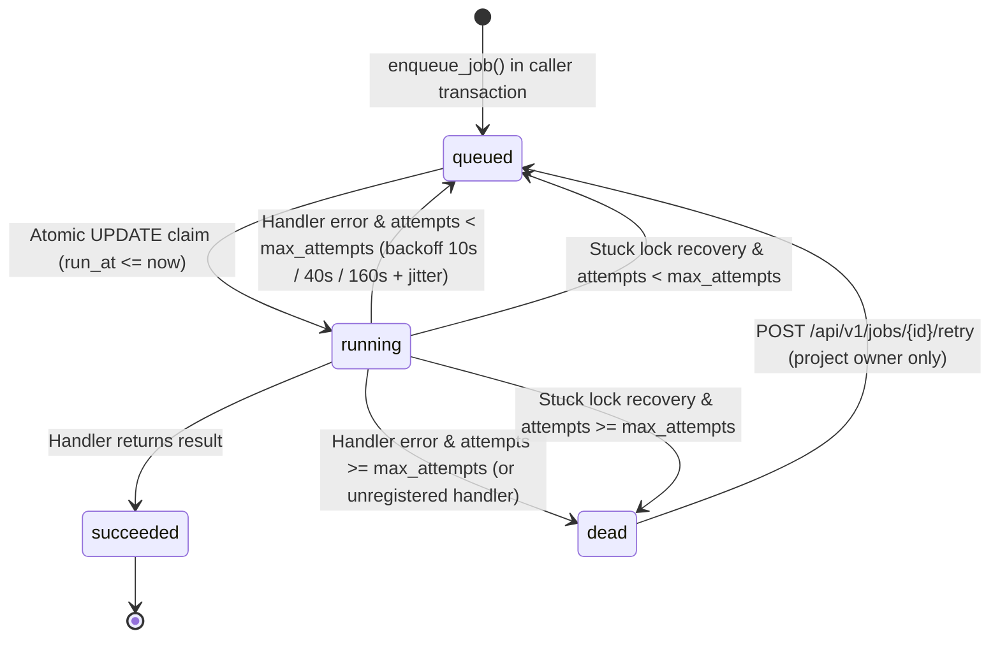

# Asynchronous Workflow & Durable Job Queue

The application runs asynchronous work using a **SQLite-backed durable job queue** (no Redis or external broker required). Jobs are stored in the same SQLite (WAL) database as domain data, which gives the system **transactional outbox** semantics: a job is committed atomically alongside the business mutation that triggered it, and rolled back if the mutation fails.

## Job Lifecycle State Diagram



## Core Mechanisms

### 1. Transactional Enqueue & Idempotency
- `app.jobs.queue.enqueue_job(db, job_type, payload, ...)` writes to `jobs` inside the caller's active SQLAlchemy session using a savepoint (`db.begin_nested()`) without committing prematurely.
- Callers may pass an `idempotency_key` (enforced by a `UNIQUE` constraint). Re-enqueueing with the same key returns the existing `Job` row rather than creating duplicate work.

### 2. Atomic Claiming (Multi-Worker Safe)
- Workers poll for due jobs (`status = 'queued'` and `run_at <= now`) ordered by `(run_at ASC, created_at ASC)` using a single conditional SQL `UPDATE ... RETURNING id`:
  - Sets `status = 'running'`, `locked_by = <worker_id>`, `locked_at = <now>`, and increments `attempts`.
  - The `WHERE` clause re-checks `status = 'queued' AND run_at <= now`. Under SQLite WAL's serialized writers, two concurrent workers cannot claim the same job.

### 3. Exponential Backoff with Jitter & Dead-Lettering
- When a handler raises an exception:
  - `last_error` is recorded (truncated to 2,000 characters) and lock fields are cleared.
  - If `attempts < max_attempts`, the job returns to `queued` with `run_at = now + delay`:
    - Attempt 1 → `10s` base (`10.0s – 11.0s` with 0–10% jitter)
    - Attempt 2 → `40s` base (`40.0s – 44.0s` with 0–10% jitter)
    - Attempt 3 → `160s` base (`160.0s – 176.0s` with 0–10% jitter)
  - Once `attempts >= max_attempts` (or if no handler is registered for `job_type`), the job transitions to `dead`.

### 4. Stuck-Job Recovery
- Before polling, workers run `recover_stuck_jobs(db, lock_timeout_seconds=300)` to detect jobs left in `running` past the lock timeout (e.g., after a worker crash or SIGKILL).
- Stuck jobs with remaining attempts are reset to `queued` (`run_at = now`); stuck jobs that already reached `max_attempts` are marked `dead`.

### 5. Handler Registry & Idempotency Contract
- Handlers are registered with `@register("job_type")` in `app.jobs.registry`.
- Because at-least-once delivery is possible after crashes, every handler **must be idempotent** (safe to re-run with the same payload).

### 6. Observability, API & Authorization
- All lifecycle transitions emit structured JSON logs including `event`, `job_id`, `job_type`, `worker_id`, and `attempts`.
- `GET /api/v1/jobs/{id}` returns `status`, `attempts`, `max_attempts`, `last_error`, and `result`. Visible only to the job's creator or members of `job.project_id` (non-members receive `404`).
- `POST /api/v1/jobs/{id}/retry` resets a `dead` project job back to `queued` with `attempts = 0`. Restricted to project **owners** (`403` for members/viewers, `404` for non-members, `409` if job is not `dead`).

## Running the Standalone Worker

```powershell
cd backend
.\.venv\Scripts\python -m app.jobs.worker
```

The worker handles `SIGINT` and `SIGTERM` gracefully, finishing the in-flight job before exiting.
