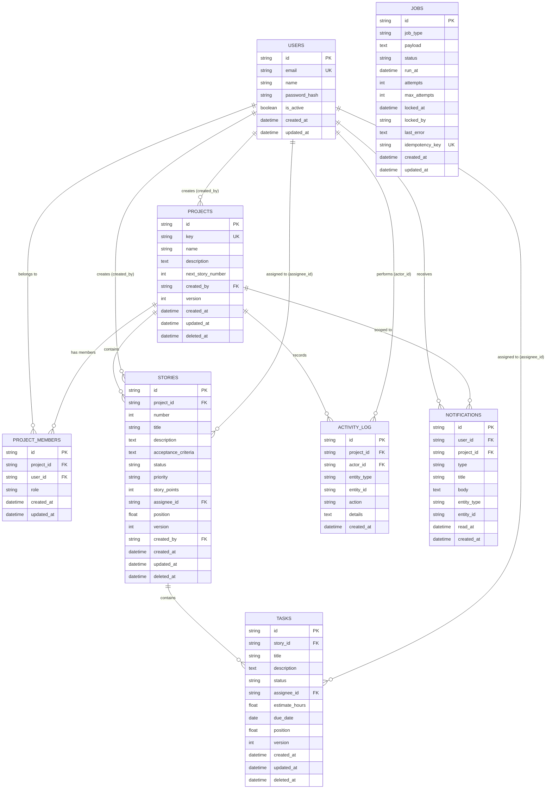

# Database Schema

The application uses **SQLite** in **WAL (Write-Ahead Logging)** mode with foreign key enforcement enabled on every connection:

- `PRAGMA journal_mode=WAL;` — allows concurrent readers alongside a single writer.
- `PRAGMA foreign_keys=ON;` — enforces all foreign key constraints at the database level.
- `PRAGMA busy_timeout=5000;` — reduces transient lock contention under concurrent requests and worker polls.

All primary keys are UUIDv4 strings (`VARCHAR(36)`). Domain entities that support soft deletion use a nullable `deleted_at` timestamp, and mutable aggregate entities (`projects`, `stories`, `tasks`) carry an integer `version` column for optimistic concurrency control (`409 Conflict` on mismatch).

## Entity-Relationship Diagram

## Entity Tables

### `users`

Stores registered team members and their credentials.

| Column | Type | Constraints | Description |
| --- | --- | --- | --- |
| `id` | `VARCHAR(36)` | `PK` | UUIDv4 identifier for the user. |
| `email` | `VARCHAR(255)` | `NOT NULL`, `UNIQUE`, `INDEX` | Normalized lowercase email address used for login. |
| `name` | `VARCHAR(120)` | `NOT NULL` | Display name shown on stories, tasks, and activity entries. |
| `password_hash` | `VARCHAR(255)` | `NOT NULL` | Argon2id password hash; plaintext passwords are never stored. |
| `is_active` | `BOOLEAN` | `NOT NULL`, default `true` | Allows deactivating an account without deleting historical references. |
| `created_at` | `DATETIME` | `NOT NULL` | UTC timestamp when the account was created. |
| `updated_at` | `DATETIME` | `NOT NULL` | UTC timestamp of the last account update. |

### `projects`

Top-level workspace container in the `Project → User Story → Task` hierarchy.

| Column | Type | Constraints | Description |
| --- | --- | --- | --- |
| `id` | `VARCHAR(36)` | `PK` | UUIDv4 identifier for the project. |
| `key` | `VARCHAR(16)` | `NOT NULL`, `UNIQUE` | Short uppercase project key (e.g., `APM`) used to format story keys like `APM-1`. |
| `name` | `VARCHAR(120)` | `NOT NULL` | Human-readable project name. |
| `description` | `TEXT` | nullable | Optional project summary or scope description. |
| `next_story_number` | `INTEGER` | `NOT NULL`, default `1`, `CHECK (>= 1)` | Monotonic per-project sequence counter incremented when creating stories. |
| `created_by` | `VARCHAR(36)` | `NOT NULL`, `FK -> users.id (RESTRICT)` | User who created the project. |
| `version` | `INTEGER` | `NOT NULL`, default `1`, `CHECK (>= 1)` | Optimistic concurrency version incremented on every update. |
| `created_at` | `DATETIME` | `NOT NULL` | UTC creation timestamp. |
| `updated_at` | `DATETIME` | `NOT NULL` | UTC last-update timestamp. |
| `deleted_at` | `DATETIME` | nullable | Soft-delete timestamp; `NULL` indicates an active project. |

### `project_members`

Join table governing project-level role-based access control.

| Column | Type | Constraints | Description |
| --- | --- | --- | --- |
| `id` | `VARCHAR(36)` | `PK` | UUIDv4 identifier for the membership record. |
| `project_id` | `VARCHAR(36)` | `NOT NULL`, `FK -> projects.id (CASCADE)` | Project the user belongs to. |
| `user_id` | `VARCHAR(36)` | `NOT NULL`, `FK -> users.id (CASCADE)` | Member user. |
| `role` | `VARCHAR(16)` | `NOT NULL`, `CHECK (role IN ('owner','member','viewer'))` | Role determining permitted actions within the project. |
| `created_at` | `DATETIME` | `NOT NULL` | UTC timestamp when membership was granted. |
| `updated_at` | `DATETIME` | `NOT NULL` | UTC timestamp of the last role update. |

- **Unique Constraints**: `(project_id, user_id)` prevents duplicate memberships.

### `stories`

User stories belonging to a project and tracked across Kanban/backlog workflow columns.

| Column | Type | Constraints | Description |
| --- | --- | --- | --- |
| `id` | `VARCHAR(36)` | `PK` | UUIDv4 identifier for the story. |
| `project_id` | `VARCHAR(36)` | `NOT NULL`, `FK -> projects.id (CASCADE)` | Owning project. |
| `number` | `INTEGER` | `NOT NULL`, `CHECK (>= 1)` | Sequential story number unique within `project_id`. |
| `title` | `VARCHAR(200)` | `NOT NULL` | Concise summary of the user story. |
| `description` | `TEXT` | nullable | Detailed context and background. |
| `acceptance_criteria` | `TEXT` | nullable | Verifiable definition of done for the story. |
| `status` | `VARCHAR(20)` | `NOT NULL`, default `'backlog'`, `CHECK (status IN ('backlog','in_progress','in_review','done'))` | Workflow column state. |
| `priority` | `VARCHAR(16)` | `NOT NULL`, default `'medium'`, `CHECK (priority IN ('low','medium','high','urgent'))` | Relative urgency of the story. |
| `story_points` | `INTEGER` | nullable, `CHECK (NULL OR 0..100)` | Optional complexity estimate in story points. |
| `assignee_id` | `VARCHAR(36)` | nullable, `FK -> users.id (SET NULL)` | User currently responsible for the story. |
| `position` | `FLOAT` | `NOT NULL`, default `1000.0` | Fractional rank used for drag-and-drop ordering within a status column. |
| `version` | `INTEGER` | `NOT NULL`, default `1`, `CHECK (>= 1)` | Optimistic concurrency version incremented on every update. |
| `created_by` | `VARCHAR(36)` | `NOT NULL`, `FK -> users.id (RESTRICT)` | User who authored the story. |
| `created_at` | `DATETIME` | `NOT NULL` | UTC creation timestamp. |
| `updated_at` | `DATETIME` | `NOT NULL` | UTC last-update timestamp. |
| `deleted_at` | `DATETIME` | nullable | Soft-delete timestamp; `NULL` indicates an active story. |

- **Unique Constraints**: `(project_id, number)`.
- **Indexes**: `ix_stories_project_id_status (project_id, status)`, `ix_stories_assignee_id (assignee_id)`.

### `tasks`

Actionable implementation tasks nested under a user story.

| Column | Type | Constraints | Description |
| --- | --- | --- | --- |
| `id` | `VARCHAR(36)` | `PK` | UUIDv4 identifier for the task. |
| `story_id` | `VARCHAR(36)` | `NOT NULL`, `FK -> stories.id (CASCADE)` | Parent user story. |
| `title` | `VARCHAR(200)` | `NOT NULL` | Short description of the task. |
| `description` | `TEXT` | nullable | Optional technical details or notes. |
| `status` | `VARCHAR(16)` | `NOT NULL`, default `'todo'`, `CHECK (status IN ('todo','doing','blocked','done'))` | Execution state of the task. |
| `assignee_id` | `VARCHAR(36)` | nullable, `FK -> users.id (SET NULL)` | User assigned to execute the task. |
| `estimate_hours` | `FLOAT` | nullable, `CHECK (NULL OR >= 0)` | Optional effort estimate in hours. |
| `due_date` | `DATE` | nullable | Optional target completion date used for overdue/due-soon checks. |
| `position` | `FLOAT` | `NOT NULL`, default `1000.0` | Fractional rank for ordering tasks within their parent story. |
| `version` | `INTEGER` | `NOT NULL`, default `1`, `CHECK (>= 1)` | Optimistic concurrency version incremented on every update. |
| `created_at` | `DATETIME` | `NOT NULL` | UTC creation timestamp. |
| `updated_at` | `DATETIME` | `NOT NULL` | UTC last-update timestamp. |
| `deleted_at` | `DATETIME` | nullable | Soft-delete timestamp; `NULL` indicates an active task. |

- **Indexes**: `ix_tasks_story_id_position (story_id, position)`, `ix_tasks_assignee_id (assignee_id)`, `ix_tasks_due_date (due_date)`.

### `activity_log`

Append-only audit trail of mutations within a project.

| Column | Type | Constraints | Description |
| --- | --- | --- | --- |
| `id` | `VARCHAR(36)` | `PK` | UUIDv4 identifier for the activity record. |
| `project_id` | `VARCHAR(36)` | `NOT NULL`, `FK -> projects.id (CASCADE)` | Project where the event occurred. |
| `actor_id` | `VARCHAR(36)` | nullable, `FK -> users.id (SET NULL)` | User who triggered the action (`NULL` for system/worker events). |
| `entity_type` | `VARCHAR(32)` | `NOT NULL`, `CHECK (entity_type IN ('project','project_member','story','task'))` | Kind of entity affected. |
| `entity_id` | `VARCHAR(36)` | `NOT NULL` | UUID of the affected entity. |
| `action` | `VARCHAR(64)` | `NOT NULL` | Action verb (e.g., `story.created`, `task.status_changed`). |
| `details` | `TEXT` | nullable | JSON-serialized summary of changed fields or metadata. |
| `created_at` | `DATETIME` | `NOT NULL` | UTC timestamp when the event was recorded. |

- **Indexes**: `ix_activity_log_project_id_created_at (project_id, created_at)`.

### `notifications`

Per-user in-app notifications generated by assignments, mentions, and background due-date checks.

| Column | Type | Constraints | Description |
| --- | --- | --- | --- |
| `id` | `VARCHAR(36)` | `PK` | UUIDv4 identifier for the notification. |
| `user_id` | `VARCHAR(36)` | `NOT NULL`, `FK -> users.id (CASCADE)` | Recipient user. |
| `project_id` | `VARCHAR(36)` | nullable, `FK -> projects.id (CASCADE)` | Related project, if applicable. |
| `type` | `VARCHAR(64)` | `NOT NULL` | Machine-readable notification category (e.g., `task.assigned`, `task.overdue`). |
| `title` | `VARCHAR(200)` | `NOT NULL` | Short headline displayed in the notification tray. |
| `body` | `TEXT` | nullable | Optional detail message. |
| `entity_type` | `VARCHAR(32)` | nullable | Optional target entity type for deep linking. |
| `entity_id` | `VARCHAR(36)` | nullable | Optional target entity UUID for deep linking. |
| `read_at` | `DATETIME` | nullable | UTC timestamp when read; `NULL` means unread. |
| `created_at` | `DATETIME` | `NOT NULL` | UTC creation timestamp. |

- **Indexes**: `ix_notifications_user_id_read_at (user_id, read_at)`.

### `jobs`

SQLite-backed asynchronous job queue polled by the background worker process.

| Column | Type | Constraints | Description |
| --- | --- | --- | --- |
| `id` | `VARCHAR(36)` | `PK` | UUIDv4 identifier for the job. |
| `job_type` | `VARCHAR(64)` | `NOT NULL` | Handler key dispatched by the worker (e.g., `send_notification`, `check_due_tasks`). |
| `payload` | `TEXT` | `NOT NULL`, default `'{}'` | JSON-encoded input arguments for the job handler. |
| `status` | `VARCHAR(16)` | `NOT NULL`, default `'pending'`, `CHECK (status IN ('pending','running','succeeded','failed','dead'))` | Lifecycle state of the job. |
| `run_at` | `DATETIME` | `NOT NULL` | Earliest UTC timestamp when the worker may claim the job (supports retries/backoff). |
| `attempts` | `INTEGER` | `NOT NULL`, default `0`, `CHECK (>= 0)` | Number of execution attempts so far. |
| `max_attempts` | `INTEGER` | `NOT NULL`, default `3`, `CHECK (>= 1)` | Maximum attempts before transitioning to `dead`. |
| `locked_at` | `DATETIME` | nullable | UTC timestamp when a worker leased the job. |
| `locked_by` | `VARCHAR(120)` | nullable | Worker instance identifier currently holding the lease. |
| `last_error` | `TEXT` | nullable | Error message or traceback from the most recent failed attempt. |
| `idempotency_key` | `VARCHAR(128)` | nullable, `UNIQUE` | Optional deduplication key to prevent duplicate job enqueues. |
| `created_at` | `DATETIME` | `NOT NULL` | UTC creation timestamp. |
| `updated_at` | `DATETIME` | `NOT NULL` | UTC last-update timestamp. |

- **Indexes**: `ix_jobs_status_run_at (status, run_at)`.
